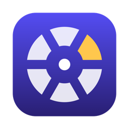
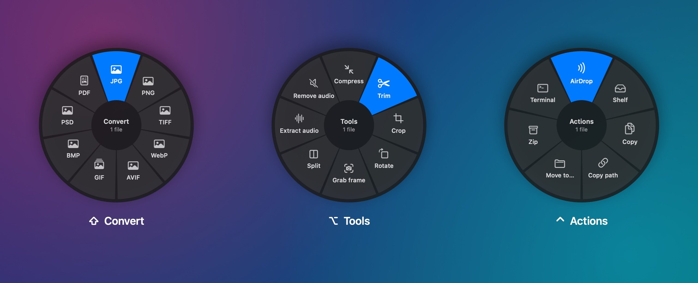
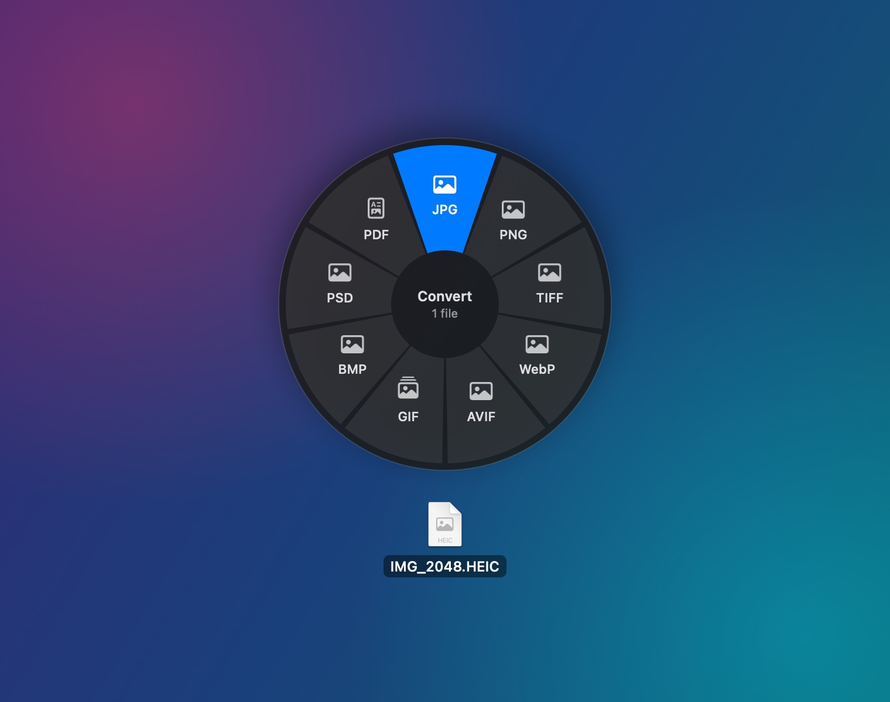
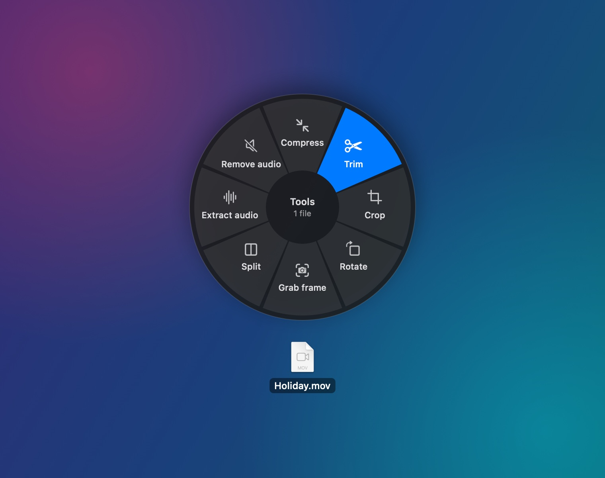
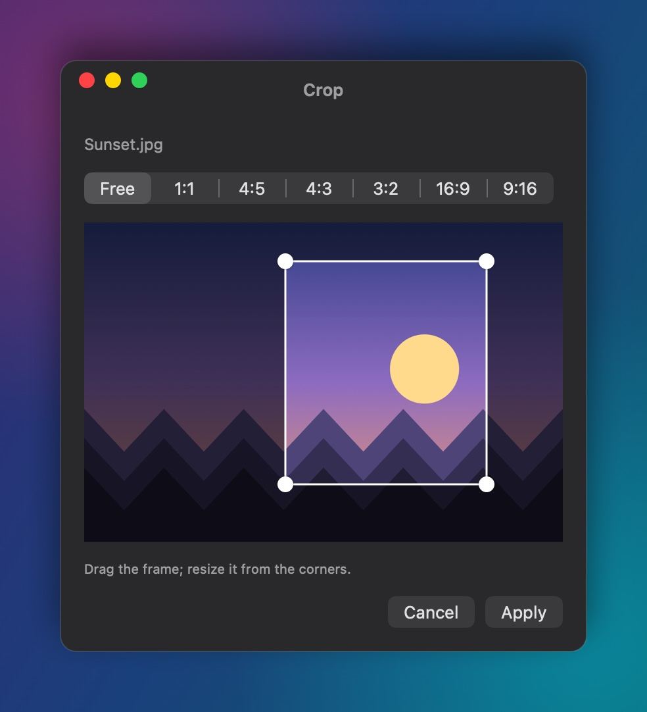
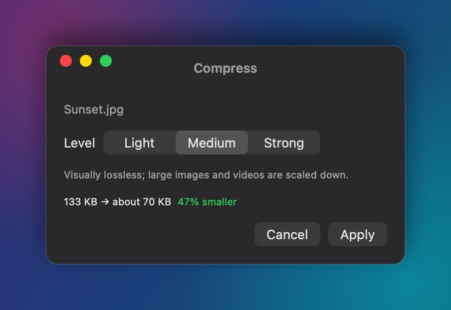
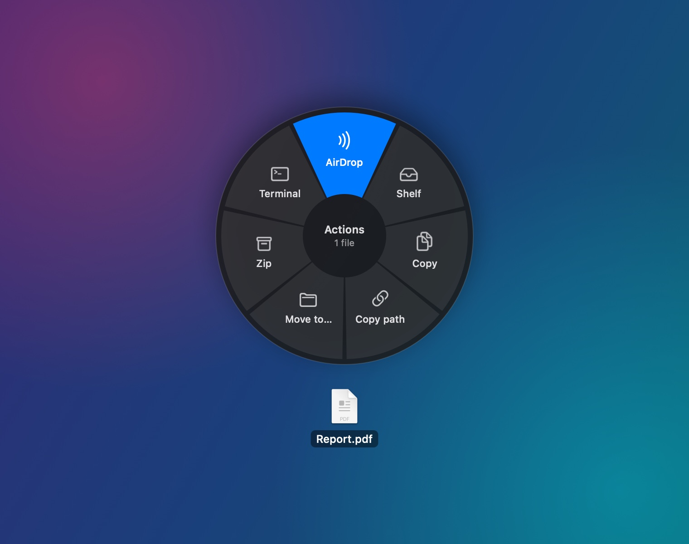
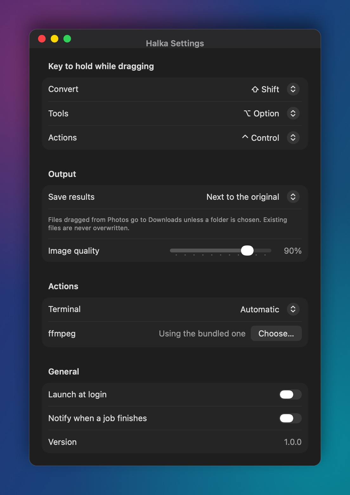

<div align="center">



# DragConvert

**Drag a file. Hold a key. Drop it on the ring.**

Convert, compress, trim, OCR and share files without opening a single app.<br>
A tiny, native macOS menu-bar utility. Everything runs on your Mac.


[](LICENSE)



</div>

Pick up any file in Finder (or a photo in the Photos app), hold <kbd>⇧</kbd>, <kbd>⌥</kbd> or <kbd>⌃</kbd>,
and a ring opens around your cursor with only the things that file can actually become or do. Release on a
slice and the result lands right next to the original.

## Why DragConvert

- **One gesture for everything.** Images, video, audio, PDFs, Word, PowerPoint and Excel files all work the
  same way: drag, hold, drop.
- **Native and light.** Swift, AppKit and SwiftUI. About 13 MB of memory, 0% CPU while idle, a 21 MB app
  that includes its own FFmpeg.
- **Private by design.** No account, no telemetry, no network code. FFmpeg is built with networking
  disabled. Files never leave your Mac.
- **Never destructive.** Originals are never modified, and an existing file is never overwritten
  (`photo.jpg` becomes `photo 2.jpg`). Half-finished output is never left behind.
- **Uses the best engine for each job.** Apple's hardware encoders for H.264/HEVC/AAC, ImageIO for photos,
  Vision for OCR and background removal, and your own copy of Microsoft Office for pixel-perfect documents.

## What it can do

### <kbd>⇧</kbd> Convert



| From | To |
|---|---|
| **Images** (HEIC, JPG, PNG, TIFF, WebP, AVIF, GIF, BMP, PSD) | any of those, or PDF |
| **Several images** | one multi-page PDF, or a PDF each |
| **Video** (MOV, MP4, MKV, WebM, M4V, AVI) | MP4, MOV, MKV, WebM, GIF, or audio (M4A, MP3, WAV) |
| **Audio** (MP3, M4A, WAV, FLAC, Opus, AIFF, AAC, OGG) | MP3, M4A, WAV, FLAC, Opus, AIFF |
| **PDF** | PNG, JPG, TIFF, HEIC (one image per page), Word, plain text (with OCR for scans) |
| **Documents** (DOCX, DOC, RTF, ODT, TXT, HTML) | each other, and PDF |
| **PowerPoint** (PPTX, PPT) | PDF, PPTX, PPT |
| **Excel** (XLSX, XLS, CSV) | PDF, XLSX, XLS, CSV |

Only conversions that are possible on your Mac appear in the ring. Photos keep their EXIF, location and
orientation; transparent PNGs become white, not black, as JPG. A video that is already H.264/HEVC is
re-wrapped instantly instead of re-encoded.

<br clear="right">

### <kbd>⌥</kbd> Tools



- **Images:** compress, resize, crop, rotate, flip, **remove background**, **extract text (OCR)**, strip
  metadata (lossless, removes GPS), merge into a PDF
- **Video:** compress, trim, crop, rotate, grab a frame, split, merge, extract or remove audio
- **Audio:** compress, trim, normalize loudness (EBU R128), split, merge
- **PDF:** compress, extract pages, extract text (OCR fallback), split into pages, rotate, add or remove a
  password, merge

Tools that need settings open a small panel with sensible defaults: press <kbd>Return</kbd> to go.

<br clear="right">

<p align="center">
  
  
</p>

Crop with a draggable frame and aspect presets, trim and grab frames on a filmstrip, and see how much
smaller a file will get *before* compressing it.

### <kbd>⌃</kbd> Actions



Things to do *with* a file rather than *to* it, for any file type:

- **AirDrop** it
- Put it on the **Shelf**, a floating tray that keeps files at hand while you find where they go
- **Copy** the file or **copy its path**
- **Move** it to another folder
- **Zip** files or **unzip** an archive
- Open its folder in **Terminal**, iTerm2 or Warp

<br clear="right">

### Works with the Photos app

Drag straight out of Photos: DragConvert asks Photos for the original file (downloading it from iCloud if
needed), converts it and saves the result to Downloads.

## Install

Requires an Apple silicon Mac with macOS 14 (Sonoma) or later.

### Homebrew

```bash
brew install --cask emirberk04/tap/dragconvert
```

### Download

Get **DragConvert-1.0.0.dmg** from the [latest release](https://github.com/emirberk04/DragConvert/releases/latest),
open it and drag DragConvert to Applications.

DragConvert is not notarized by Apple yet, so the first launch is blocked. Open it once with
**System Settings › Privacy & Security › Open Anyway**, or run:

```bash
xattr -dr com.apple.quarantine /Applications/DragConvert.app
```

The Homebrew cask does this for you.

### Build from source

```bash
git clone https://github.com/emirberk04/DragConvert.git
cd DragConvert
scripts/build-ffmpeg.sh          # one time, about 5 minutes: FFmpeg and codecs from official sources
scripts/build-app.sh --install   # builds DragConvert.app into ~/Applications and opens it
```

Without FFmpeg, DragConvert still handles images, PDFs and documents; video and audio targets simply do not
appear. `scripts/make-dmg.sh` builds the release disk image.

### Permissions

DragConvert needs no special permission to work. macOS asks only for things you use:

- **Automation** for Word, PowerPoint or Excel, the first time a document is converted with them
- **Notifications**, if you turn on "Notify when a job finishes"

## Usage

| Hold while dragging | Ring | Example |
|---|---|---|
| <kbd>⇧</kbd> Shift | Convert | iPhone HEIC → JPG, MOV → MP4, DOCX → PDF |
| <kbd>⌥</kbd> Option | Tools | Trim a video, remove a background, OCR a screenshot |
| <kbd>⌃</kbd> Control | Actions | AirDrop, Shelf, Zip, open in Terminal |

- Release the key to close the ring and carry on with a normal drag.
- Drop in the centre to cancel.
- Select several files to process them together.
- Progress and **Stop** are in the menu bar; recent results are under **Recent Files**.



**Settings** let you change the trigger keys, save every result to one folder, set image quality, choose
your terminal, point to your own FFmpeg, launch at login and get a notification when long jobs finish.

The interface is in English, and in Turkish when macOS is set to Turkish.

<br clear="right">

## How it works

- **Drag detection** needs no Accessibility permission: a global mouse-down monitor starts a short-lived
  timer only while the button is held, which watches the system drag pasteboard and the modifier keys. When
  the mouse is up, nothing runs.
- **The ring** is a non-activating panel under the cursor that becomes the drop target, so the source app
  never sees the drop. Apps like Photos offer *file promises* instead of paths; DragConvert receives the real file.
- **Engines:** ImageIO and Core Graphics for images and PDFs; PDFKit for PDF tools; Vision for OCR and
  background removal; a bundled FFmpeg 9 (shared libraries, no network, no GPL code) for video and audio;
  macOS `textutil` for text documents; AppleScript automation of Microsoft Office for Office formats.
- **Safety:** every result is written to a temporary file first and moved into place under a free name.

```
Sources/
  DragConvertCore   formats, conversions and tools, no AppKit (unit-tested)
  DragConvertDrag   drag detection, trigger state machine, ring geometry
  DragConvertUI     ring panel, tool panels, Shelf, Settings
  DragConvertApp    menu bar and glue
```

## Development

```bash
swift build
swift test                                          # ~95 tests, including real FFmpeg conversions
RENDER_SCREENSHOTS=1 swift test --filter Screenshots  # regenerates the images in this README
```

FFmpeg integration tests run when `Vendor/ffmpeg` exists (after `scripts/build-ffmpeg.sh`) and are skipped
otherwise. Some code comments are still in Turkish; translations are welcome.

## Roadmap

- [ ] Notarized release (no Gatekeeper prompt)
- [ ] Intel build
- [ ] More formats: HEIF sequences, EPUB, subtitles
- [ ] Finder Quick Actions for keyboard-only use

Ideas and bug reports are welcome in [Issues](https://github.com/emirberk04/DragConvert/issues).

## License

DragConvert is released under the [MIT License](LICENSE). It builds on FFmpeg, LAME, libvpx, libwebp and Opus;
see [THIRD_PARTY_NOTICES.md](THIRD_PARTY_NOTICES.md).
